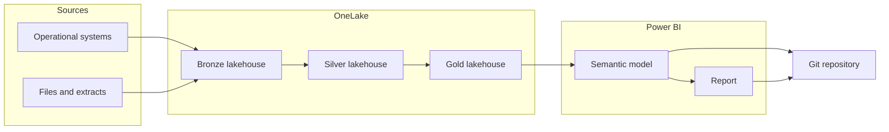

# Fabric lakehouse to a Power BI semantic model in PBIP

Part of the [reference architectures](../README.md).

This note describes one way to take operational data through a medallion lakehouse and into a Power BI semantic model and report, stored as a Power BI project (PBIP). The medallion shape is a general lakehouse pattern. The implementation detail here is Microsoft Fabric and Power BI, because that is the pairing this note is about.

Examples use a generic `sales` domain. This is reference guidance for a class of system. It is not a record of a particular delivery. How a change moves from a branch into test and production is covered in [CI/CD for PBIP projects](../pbip-cicd/README.md).

## Context and problem

Operational data is rarely fit to report on as it arrives. It has source-system names, duplicates, late files, and columns that mean different things in different feeds. If each report cleans that data in its own Power Query, the organisation ends up with several versions of "sales" and no single place to correct them.

A medallion lakehouse gives the data a path with a quality contract at each step. Bronze keeps what arrived. Silver makes it consistent. Gold shapes it for a decision. A semantic model then defines the relationships, measures, and row-level rules that reports share. The report stays thin.

Storing the model and the report as PBIP, using TMDL for the model and PBIR for the report, puts that definition in Git as text. Reviewers can see a measure or a security role change in a pull request, instead of inside a binary PBIX file.

## Architecture



Ingestion lands source data in the bronze lakehouse, by copy or by a shortcut when the data already lives somewhere OneLake can reference. Pipelines or notebooks move data from bronze to silver, then from silver to gold. The semantic model reads the gold Delta tables. The report reads the semantic model. The PBIP project in Git holds the model and the report, not a second copy of the rows.

## Components and responsibilities

| Component | Responsibility |
| :-- | :-- |
| Sources | Systems of record and file drops. This pattern does not change them. |
| Ingestion | Land data in bronze. Record enough to trace a load back to a source file or extract. |
| Bronze lakehouse | Raw data, kept in the shape it arrived. The contract is "what we received", not "what a report needs". |
| Silver lakehouse | Cleansed, typed, deduplicated, and renamed to conformed business names. |
| Gold lakehouse | Tables shaped for analysis, usually a star schema, and stable enough for a semantic model to bind to. |
| Orchestration | Run ingest and transformation in order, and fail in a way an operator can see. |
| Semantic model | Relationships, measures, display names, and the row-level security that report readers hit. Stored as TMDL. |
| Report | Pages and visuals in PBIR. Calculations that more than one report needs belong on the model. |
| Git | History of the model and the report. Transformation code belongs in Git as well once the team is operating it, which the [CI/CD note](../pbip-cicd/README.md) picks up. |

A lakehouse in Fabric stores tables in OneLake, with a SQL analytics endpoint for SQL access. Spark notebooks, Data Factory pipelines, and Dataflow Gen2 can all write Delta tables. Pick one tool per transformation. The same business rule should not live in a notebook and a dataflow.

## Design decisions and trade-offs

### Direct Lake and Import

Direct Lake and Import both end up querying through the VertiPaq engine once data is in memory. They differ in how the data gets there.

Direct Lake reads Delta tables in OneLake. A refresh frames metadata and points the model at the latest Delta version. It does not copy the whole table into the model. Data preparation stays in the lakehouse. There are two forms:

- **Direct Lake on OneLake** reads Delta tables directly, including through shortcuts. It does not fall back to DirectQuery. It can sit in a composite model with Import tables, and it can use OneLake security. This is the default in this note when gold is Delta and the team wants one predictable behaviour.
- **Direct Lake on SQL** uses the SQL analytics endpoint for discovery and permission checks, against a single Fabric source. Queries over a SQL view fall back to DirectQuery, which is slower and surprising if nobody planned for it. Choose this form when the model must honour row, column, or object security defined on that SQL endpoint in delegated identity mode.

Import copies rows into the model on refresh. Power Query is available, the model is self-contained, and readers do not need access to the lakehouse. The cost is a second copy, a refresh that grows with volume, and capacity spent loading data that the lakehouse already stores. Import is the better fit for a small model, a source that will not land as Delta, or a prototype that has not earned a lakehouse yet.

DirectQuery, as a storage mode in its own right, pushes each visual query to the source. It is not the target mode for this pattern. It appears here mainly as the fallback behaviour of Direct Lake on SQL.

Two limits are easy to miss. Direct Lake needs Fabric capacity. And modelling features are not identical to Import. Guidance on developing Direct Lake models currently marks calculated columns and calculated tables that reference Direct Lake tables as preview. Recheck that guidance before depending on them. Prefer a column prepared in gold, and a measure in the semantic model.

For Direct Lake on OneLake, deployment pipelines do not offer data source rules. Environment-specific workspace and lakehouse bindings are handled with text parameters. That detail is in the [CI/CD note](../pbip-cicd/README.md).

### Where transformations live

| Layer | What belongs here | What does not |
| :-- | :-- | :-- |
| Bronze | Land the extract. Optionally record ingestion metadata such as load time and source file name. | Business rules, deduplication that changes meaning, report measures. |
| Silver | Types, keys, deduplication, conformed names, and the quality checks that decide whether a row may move on. | Visual formatting, measure logic. |
| Gold | A star schema or another shape with a clear grain, surrogate keys, and the columns the model will relate and filter. | A private copy of silver's cleansing rules. |
| Semantic model | Relationships, measures, display folders, calculation groups if they earn their place, and report-facing row-level security. | Row cleansing, type fixes, another rename of a column that silver already named. |
| Report | Pages, visuals, and filters that serve one decision. | A measure that a second report will need. Put that on the model. |

Microsoft's medallion guidance treats bronze as raw: store data as it arrives, and do not apply business changes. Ingestion metadata is acceptable because it explains the load. It is not a business transformation. Silver and gold should be Delta tables so Fabric engines can share them.

If a rule is implemented in Power Query, it will not run for a Direct Lake table. That is a reason to transform upstream, not a reason to keep a hidden Power Query copy "just in case".

### Naming

The names below are a suggestion for the `sales` example, not a product requirement. The rule that matters is consistency. Environment belongs on the workspace, not on the item. A deployment pipeline copies item names from stage to stage, so `sales-dev` on a report becomes an awkward production name.

| Object | Example | Note |
| :-- | :-- | :-- |
| Workspace | `sales-dev`, `sales-test`, `sales-prod` | One workspace per environment. |
| Lakehouse | `sales_bronze`, `sales_silver`, `sales_gold` | Same item name in each environment. |
| Table | `sales_order`, `customer`, `product`, `date` | snake_case nouns. No environment prefix. |
| Column | `order_date`, `customer_key` | snake_case. Pick `_key` or `_id` and keep it. |
| Semantic model | `sales` | Measures use business language, such as `Order amount`. |
| Report | `sales` | Pages named for the decision, not the chart type. |

Silver names are the conformed names. Gold should reuse them rather than invent a third spelling. A rename between layers needs a reason a later owner can find.

### Workspace layout

The default in this note is three lakehouses, one per layer, inside an environment workspace:

- `sales-dev`, `sales-test`, and `sales-prod` are the workspaces.
- Each holds `sales_bronze`, `sales_silver`, `sales_gold`, the `sales` semantic model, and the `sales` report.
- A Fabric deployment pipeline maps one workspace to each stage. Item names do not change as content is promoted.

Separate lakehouses match the medallion guidance to keep each layer in its own lakehouse or warehouse, and they give a clearer boundary for who can read raw data. The trade-off is more items to deploy and bind.

Two other layouts are reasonable:

- **Schemas in one lakehouse.** A single `sales` lakehouse with `bronze`, `silver`, and `gold` schemas is easier to operate for a small domain with one owning team. The permission boundary is coarser unless OneLake security is used to narrow it. Lakehouse schemas are a documented Fabric feature, not a different architecture.
- **Gold as a warehouse.** Bronze and silver stay lakehouses, and gold is a Fabric warehouse written with T-SQL. Choose this when the team standardises on SQL and the data is structured. This note stays lakehouse-first. The warehouse option is the other pattern in the medallion guidance.

Do not split layers across workspaces unless access truly requires it. Cross-workspace shortcuts and several deployment pipelines add binding work. If bronze must be harder to reach than the report, prefer a tighter role on the bronze lakehouse, or a separate data workspace, and test that a report reader cannot open it.

## Governance and security

Workspace role, row-level security, and sensitivity labels are three different controls. Set each one on purpose.

### Workspace roles

Fabric workspace roles are Admin, Member, Contributor, and Viewer.

Admins, Members, and Contributors can read and write the data in the workspace. OneLake row-level and column-level security does not apply to those roles. Viewers do not get OneLake read access by default. A OneLake security role can grant it.

That split should drive membership:

- Engineers who build pipelines are Contributors on `sales-dev`. They do not need the same role on `sales-prod`.
- Report readers are Viewers on the production workspace, or they receive the report through an app. They are not Contributors.
- Membership changes are rare and reviewed. A Contributor on production can see bronze, ignore semantic-model row-level security, and edit items the deployment pipeline just promoted.

OneLake security roles grant access to data for Viewers and for others with Read on the item. They can be scoped to tables, folders, schemas, columns, and rows. A lakehouse also has a DefaultReader role, which grants access to users who have ReadAll on the item. Review that role when report users and engineers share a workspace.

### Row-level security

Use two mechanisms only when both are actually needed, and do not assume they stay in step.

**Semantic model row-level security** is what report readers experience. Roles and filter expressions live in the model, so they are visible in the PBIP project and in pull requests. In the service, this security applies to Viewers. It does not apply to workspace Admins, Members, or Contributors, even if those people only meant to "have a look". Assign readers the Viewer role if the filter must apply to them.

An illustrative shape, not a production rule: a role `regional_sales` filters `sales_territory` through a small security table keyed by the reader's sign-in, so each person sees one region. Test it as a Viewer. "View as role" is not a full substitute for that test.

**OneLake row-level security** filters tables for engines that honour OneLake security, for people who can query the lakehouse rather than only open the report. It also does not restrict Admins, Members, or Contributors. Rules are defined on the lakehouse, not in the PBIP files. A person who is a Viewer on the workspace and a member of a OneLake role can still see rows the semantic model would hide, if they can query the lakehouse directly.

If both layers are required, write both down, keep the predicates aligned on purpose, and test with an account that has no build role. Direct Lake on SQL can instead rely on row-level security at the SQL analytics endpoint. That is a different path again, and it is one of the reasons to choose Direct Lake on SQL. Pick one place to be authoritative for a given rule.

### Sensitivity labels

Apply a sensitivity label to the lakehouse, the semantic model, and the report when the tenant provides labels. A label classifies the item and can travel with supported exports. It is not itself a permission.

A protection policy tied to a label can block people who are outside an allow list. The person who last applied that label is not blocked by the policy. Labels and protection policies depend on Microsoft Purview Information Protection being set up for the tenant. Do not describe a label as "locked down" unless a protection policy or a real permission is doing the locking.

Endorsement is separate again. Certifying the gold model is useful once a named owner will stand behind it. Endorsement without an owner is decoration.

## Repository layout

A PBIP project is usually its own Git repository. The layout below is for that repository. It is not a folder in this profile repo.

Save as a Power BI project, with PBIR for the report and TMDL for the semantic model. PBIR keeps pages and visuals as separate JSON files, so a pull request can show a visual change without a rewrite of one large file. TMDL splits the model by table and by other objects such as roles. Both formats are documented and suited to review. The older single-file report format, PBIR-Legacy, is a weaker fit for the same reason a binary PBIX is a weaker fit.

```text
sales-pbip/
├── .gitignore
├── sales.pbip
├── sales.Report/
│   ├── definition.pbir
│   └── definition/
│       ├── pages/
│       ├── report.json
│       └── version.json
└── sales.SemanticModel/
    ├── definition.pbism
    └── definition/
        ├── model.tmdl
        └── tables/
```

A full Desktop save also includes `.platform`, `diagramLayout.json`, and further TMDL files for relationships, roles, and perspectives. Follow the current project folder documentation rather than treating the tree above as a complete file list.

`definition.pbir` should reference the model with a relative `byPath`, so Desktop opens the model with the report. Absolute paths are not supported. Illustrative fragment:

```json
{
  "version": "4.0",
  "datasetReference": {
    "byPath": {
      "path": "../sales.SemanticModel"
    }
  }
}
```

Do not commit `.pbi/localSettings.json` or `.pbi/cache.abf`. Those are local. `editorSettings.json` is shared and can be committed. This profile repository ignores the two local paths in [`.gitignore`](../../.gitignore). A PBIP repository needs the same ignore rules in its own `.gitignore`. Power BI Desktop writes a `.gitignore` when it saves a project. Keep it.

One semantic model can serve more than one report. Each report folder has its own `definition.pbir` pointing at the same model folder. Resist a second model that only exists to rename a measure.

## When to use this pattern

Use it when more than one report or team depends on the same sales facts, when the data is large or refreshed often enough that copying it into an Import model is the expensive part, and when the model and report need a reviewable history. It earns its place when someone must trace a gold row back to bronze, and when report readers must not be editors of the lake.

## When not to use it

Do not start here for a single small report over a spreadsheet or a one-off extract. An Import PBIP model, or even a PBIX while the question is still forming, is enough until the data has more than one consumer.

Do not insist on Direct Lake when the source cannot be a Delta table in OneLake, when there is no Fabric capacity, or when the team needs Power Query as the transformation engine and will not move those steps upstream. Do not build three lakehouse layers for a handful of tables that are already clean and only used once. A schema, or a single gold table, is a valid smaller shape.

Do not use this pattern as a reason to give report readers Contributor on the workspace. The layout only works if the role split in the governance section is real.

## Further reading

These are Microsoft Learn pages. Product behaviour changes, so recheck the Direct Lake and security pages before treating a limit as fixed.

- [Implement medallion lakehouse architecture in Fabric](https://learn.microsoft.com/en-us/fabric/onelake/onelake-medallion-lakehouse-architecture)
- [OneLake patterns and foundational capabilities](https://learn.microsoft.com/en-us/fabric/onelake/architecture-patterns)
- [What is a lakehouse?](https://learn.microsoft.com/en-us/fabric/data-engineering/lakehouse-overview)
- [Lakehouse schemas](https://learn.microsoft.com/en-us/fabric/data-engineering/lakehouse-schemas)
- [Direct Lake overview](https://learn.microsoft.com/en-us/fabric/fundamentals/direct-lake-overview)
- [Develop Direct Lake semantic models](https://learn.microsoft.com/en-us/fabric/fundamentals/direct-lake-develop)
- [Power BI Desktop projects](https://learn.microsoft.com/en-us/power-bi/developer/projects/projects-overview)
- [Power BI project report folder](https://learn.microsoft.com/en-us/power-bi/developer/projects/projects-report)
- [Power BI project semantic model folder](https://learn.microsoft.com/en-us/power-bi/developer/projects/projects-dataset)
- [Workspace roles](https://learn.microsoft.com/en-us/fabric/fundamentals/roles-workspaces)
- [Data security in OneLake](https://learn.microsoft.com/en-us/fabric/onelake/security/get-started-security)
- [OneLake table, column, and row-level security](https://learn.microsoft.com/en-us/fabric/onelake/security/table-column-row-security)
- [Row-level security for semantic models](https://learn.microsoft.com/en-us/fabric/security/service-admin-row-level-security)
- [Sensitivity labels in Power BI](https://learn.microsoft.com/en-us/fabric/enterprise/powerbi/service-security-sensitivity-label-overview)
- [Protection policies in Fabric](https://learn.microsoft.com/en-us/fabric/governance/protection-policies-overview)
- [Endorsement](https://learn.microsoft.com/en-us/fabric/governance/endorsement-overview)
