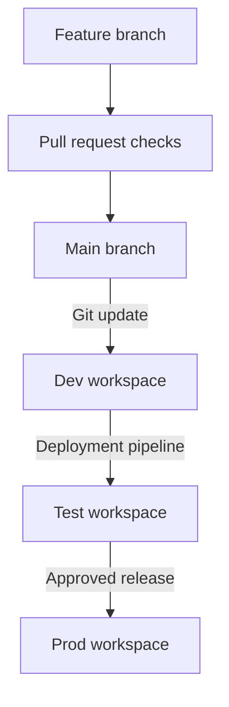

# CI/CD for PBIP projects

Part of the [reference architectures](../README.md).

This note continues from [Fabric lakehouse to a Power BI semantic model in PBIP](../fabric-lakehouse-to-pbip/README.md). That note covers how `sales` data is shaped, modelled, and stored as a PBIP project. This one covers how a change on a branch reaches a production workspace without someone editing production by hand.

The moving parts are ordinary ones. Git holds the text. A pull request is the review. GitHub Actions or Azure Pipelines runs the checks and, where you automate promotion, calls Microsoft Fabric. Fabric Git integration syncs a dev workspace with a branch. Fabric deployment pipelines, or a deploy library such as fabric-cicd, promote content from dev to test to prod.

This is reference guidance. The YAML later in the note is an example, not a pipeline to copy into this repository.

## Context and problem

A PBIP project is text, so Git can diff it. That only helps if the file in Git and the item in the workspace are the same change. Teams get into trouble when a developer edits the shared dev workspace, someone else edits the PBIP files locally, and production is updated from whichever copy was open last.

The aim is a single direction of travel:

1. Change the project on a short-lived branch.
2. Review it in a pull request, with automated checks where they earn their place.
3. Merge to the integration branch and update the dev workspace from that branch.
4. Promote the tested content to test, then to prod, through a deployment pipeline or an API deploy.
5. Do not author in prod. A fix goes back through a branch.

GitHub Actions and Azure Pipelines can both host those checks. Fabric does not care which runner you use. Pick the one the team already runs and protects.

## Flow



The first half is Git. The second half is Fabric. Merging to `main` does not, by itself, publish to production. Production is a later, approved step.

## Branching strategy

Use a short trunk. `main` is the integration branch. Feature branches come off `main` and merge back through a pull request. Protect `main`: require the pull request, require the validation check, and do not allow direct pushes.

Keep feature branches short. A PBIP diff is readable when it is one change. It is not readable when two weeks of report edits land in one commit. Commit related model and report changes together so a promotion does not take the report without the measure it depends on.

Authors work in Power BI Desktop on the feature branch, or in their own workspace connected to that branch. They do not commit straight to the branch the shared dev workspace tracks. Fabric's own lifecycle guidance makes the same point: use an isolated environment, and commit to a branch you created, so two people do not overwrite each other.

The shared `sales-dev` workspace tracks `main`. After a merge, someone or something updates that workspace from Git. Test and prod do not track `main`. If they did, a sync could push an unreviewed edit from the service back into the branch, or move production without the test step.

Some teams also keep a long-lived branch per environment as a record of what was released. That can work, with two costs. The workspace has to be re-pointed at each new release branch, and any change the pipeline makes to source before deploy will not be represented by a plain Git connection. For the `sales` pattern, prefer one integration branch plus a deployment pipeline. Add environment branches only if you need Git itself to be the ledger of each promotion.

Large images inside a report make noisy, heavy diffs. Keep static assets small.

## Pull request validation

A pull request on a PBIP change should answer three questions. Is the file valid. Does the model still follow the rules the team cares about. Does a person understand the measure and security change.

**Structure and schema.** PBIR JSON files declare a public schema, and Desktop validates them on open. A pull request check can fail earlier: confirm the expected files exist (`sales.pbip`, `definition.pbir`, `definition.pbism`) and validate the PBIR JSON against the schemas those files declare. This catches a broken edit. It does not catch a wrong measure.

**Review of the text.** TMDL shows tables, relationships, measures, and row-level security roles as text. The reviewer looks at those, not only at the green check. A change to a role filter is a security change.

**Third-party best-practice checks, if you choose to run them.** These are not Microsoft Fabric features.

- Tabular Editor Best Practice Analyzer is part of Tabular Editor, a third-party product. Rule sets differ, including community rule sets. Treat a finding as review input. A clean run is not proof the model is right.
- PBI Inspector is a third-party checker some teams use for report and model rules. The same caution applies. Pin the version and the rules you meant to run, or the check will drift.

Do not block a pull request on a third-party rule the team has not read. Start with schema validation and a human look at measures and roles. Add a third-party ruleset when it encodes a rule you would otherwise repeat in review.

Fabric Git integration can also validate by updating a personal workspace from the branch before merge. That finds items the service will not accept. It costs a workspace and a service principal path, so it is a later step, not the first check.

## Promotion from dev to test to prod

Microsoft's CI/CD guidance describes the efficient path as: connect the developer workspace to Git, then deploy onward with deployment pipelines. For `sales`, that looks like this.

| Stage | Workspace | What happens |
| :-- | :-- | :-- |
| Dev | `sales-dev` | Tracks `main`. Updated from Git after merge. Engineers can still investigate here. They do not use it as the production copy. |
| Test | `sales-test` | Receives a deployment from dev. Reviewers and automated checks run against data and a capacity that are close enough to production to be honest. Nothing is changed here between the test sign-off and the prod deployment. If it changes, test it again. |
| Prod | `sales-prod` | Receives a deployment from test after a person approves it. Readers are Viewers. Authors do not edit items here. |

Deployment pipelines copy items from one stage workspace to the next and can apply rules for values that differ by environment. A pipeline can have from two to ten stages. Three is enough for this pattern.

Direct Lake on OneLake needs extra care. Deployment pipelines do not provide data source rules for that connection. Use text parameters for the workspace and lakehouse identifiers, and set a parameter rule on the target stage. The gold tables in the target workspace must already exist and match the names the model expects. Changing a parameter does not create tables or grant access. After promotion, refresh the framing on the target model and check the lineage.

Other environment-specific values, such as a connection or a variable library value set, should be set per stage rather than edited into the PBIP files on `main`. Otherwise `main` becomes the production configuration.

Who may start the prod deployment should be a short list. The dev workspace can be looser. The prod workspace should not be.

An alternative to deployment pipelines is to deploy the Git definition with the Fabric REST APIs or with fabric-cicd, the open-source library Microsoft documents for deploying item definitions from source control. fabric-cicd can rebind environment-specific values and can remove items that were deleted in Git. Use it when you want the runner, not the pipeline UI, to be the thing that publishes. You do not need both mechanisms for the same hop. Two publishers for one workspace will eventually disagree.

A third option is Git integration on every stage, using release branches. It is documented, and it is usually more awkward than a deployment pipeline for this pattern. It is noted here so the trade-off is explicit, not as the default.

## Secrets and identity

Automated calls to Fabric run as an Entra application, a service principal, not as a person who happened to be logged in on a build agent.

Prefer workload identity federation. The runner presents a short-lived token from GitHub Actions or Azure Pipelines, and Entra exchanges it for an access token. No client secret is stored in the repository or in the pipeline. GitHub Actions needs `id-token: write` on the workflow, and a federated credential on the app registration whose subject matches the repository and the branch or environment you intend. Azure Pipelines can use a service connection with workload identity federation for the same idea.

If federation is not available, a client secret is the fallback. Store it in the CI secret store or in a key vault the pipeline can reach. Rotate it. Never commit it, and never put it in a workflow file, even as a placeholder that looks real.

The principal still has to be allowed into Fabric.

- A Fabric administrator enables **Service principals can call Fabric public APIs**, and puts the principal in the security group that setting allows. Creating workspaces, connections, or deployment pipelines is a separate tenant setting. Do not turn on more of these than the pipeline uses.
- Grant the principal a workspace role on each workspace it must change. The Fabric CI/CD tutorial adds the principal as Member or Admin on the target workspaces. Confirm the current minimum for the API you call. Admin on every workspace is more than a deploy job usually needs. The principal is also subject to the same row-level security limits as any other Admin, Member, or Contributor: those roles are not filtered. Keep the principal out of workspaces it does not deploy to.
- Connecting a workspace to Git as a service principal is documented for Azure DevOps. The end-to-end Fabric automation tutorial says that using a service principal to connect a workspace to GitHub is not currently supported. You can still use GitHub. Connect the dev workspace to the GitHub repo through the portal, and let the service principal call the deployment or item APIs. If the Git connection itself must be created by the principal, Azure DevOps is the documented path today. Recheck that limitation. It is a product limit, not a reason to avoid GitHub for the pull request.

Directory IDs, client IDs, and workspace IDs are configuration. They are not secret in the same way a client secret is, but they still do not belong in a public example. Pass them as pipeline variables.

## Example pipeline

The workflow below is an example for a different repository, one that contains the `sales` PBIP project. It is not a working pipeline, and it is not part of this profile repo. Every ID is a placeholder name. Action versions move. Check them before use.

What the example is trying to show:

- Pull requests run a structural check. They do not deploy.
- A push to `main` signs in with workload identity federation and is the moment to update **dev** only.
- Production is a separate, manually started run with an environment approval. It is not chained off every merge.

```yaml
# Example only. Not a complete pipeline.
# Placeholder names, not real directory, client, or workspace IDs.
# Do not add a client secret to this file.

name: sales-pbip

on:
  pull_request:
  push:
    branches: [main]
  workflow_dispatch:

permissions:
  contents: read
  id-token: write

jobs:
  validate:
    if: github.event_name == 'pull_request'
    runs-on: ubuntu-latest
    steps:
      - uses: actions/checkout@v4
      - name: Check the PBIP layout
        run: |
          test -f sales.pbip
          test -f sales.Report/definition.pbir
          test -f sales.SemanticModel/definition.pbism
      - name: Schema and rule checks
        run: |
          echo "Validate PBIR JSON against the schemas declared in the files."
          echo "Optionally run a pinned third-party checker."
          echo "Tabular Editor BPA and PBI Inspector are third-party tools."

  update-dev:
    if: github.event_name == 'push' && github.ref == 'refs/heads/main'
    runs-on: ubuntu-latest
    environment: sales-dev
    steps:
      - uses: actions/checkout@v4
      - name: Sign in with workload identity federation
        uses: azure/login@v2
        with:
          client-id: ${{ vars.ENTRA_CLIENT_ID }}
          tenant-id: ${{ vars.ENTRA_TENANT_ID }}
          allow-no-subscriptions: true
      - name: Update the dev workspace from this commit
        env:
          SALES_DEV_WORKSPACE_ID: ${{ vars.SALES_DEV_WORKSPACE_ID }}
        run: |
          echo "Placeholder. This step does not deploy anything."
          echo "Call the Fabric Git update API or fabric-cicd for ${SALES_DEV_WORKSPACE_ID}."

  release-prod:
    if: github.event_name == 'workflow_dispatch'
    runs-on: ubuntu-latest
    environment: sales-prod
    steps:
      - uses: actions/checkout@v4
      - name: Sign in with workload identity federation
        uses: azure/login@v2
        with:
          client-id: ${{ vars.ENTRA_CLIENT_ID }}
          tenant-id: ${{ vars.ENTRA_TENANT_ID }}
          allow-no-subscriptions: true
      - name: Promote the tested content to prod
        run: |
          echo "Placeholder. This step does not deploy anything."
          echo "Run the approved dev-to-test or test-to-prod deployment."
          echo "Do not chain this job off every push to main."
```

An Azure Pipelines equivalent uses a service connection with workload identity federation, a validation stage on pull requests, and an environment approval before production. The Fabric steps are the same. Only the runner syntax changes.

`allow-no-subscriptions` is set because this job needs an Entra token for Fabric, not an Azure subscription. The federated credential on the app registration has to trust this repository and the environment or branch that runs the job. Without that trust, the sign-in step cannot succeed. The `echo` steps are deliberately not a deployer.

## Design decisions and trade-offs

**Git integration plus deployment pipelines, versus API deploy.** Pipelines are the simpler promotion tool when the items are supported and a person may still click deploy. API deploy, including fabric-cicd, fits when promotions must be repeatable from the runner and when deleted items must disappear from the target. Running both for the same hop is how environments drift.

**GitHub and Azure DevOps.** Either can store the repo and run the checks. Portal Git integration supports both. Non-interactive, service-principal setup of the Git connection is documented for Azure DevOps, and the current end-to-end tutorial does not support that connection step for GitHub. Choose on that constraint and on where the team's permissions already live, not on brand.

**Federation versus a client secret.** Federation removes a long-lived secret from the runner. A client secret is easier to set up and easier to leak. Prefer federation. If you use a secret, keep it in a secret store and rotate it.

**How much the pull request checks.** Schema checks are cheap and stable. Third-party best-practice tools catch style and a class of modelling mistakes, and they also fail on rules you do not care about. A person still reads measure and row-level security diffs. Automation does not replace that read.

**Parameter rules versus one set of files.** Direct Lake on OneLake will not rebind itself through a data source rule. Parameters, or an explicit rebind in fabric-cicd, are the honest options. Hard-coding a workspace identifier in the committed TMDL ties every environment to dev.

**How close test is to prod.** A test stage that holds a tiny sample will not show a Direct Lake framing or capacity problem. Lifecycle guidance asks for similar data volume, usage, and capacity, on a capacity that is not the production capacity if a load test would put production at risk. Match that as far as the team can afford. Say so when test is a reduced copy, so nobody treats a green test as a production proof.

## When to use this pattern

Use it when more than one person changes the model or the report, when production has readers who are not the authors, and when you need a record of what was reviewed before it was promoted. It pairs with the lakehouse note once the semantic model and report are PBIP and the workspaces are split into dev, test, and prod.

## When not to use it

Do not build this for a single author publishing a throwaway PBIX. The machinery will be larger than the report.

Do not adopt it if nobody will keep Git and the dev workspace aligned. A deployment pipeline that promotes whatever was last clicked in dev, while Git says something else, is a second source of truth. Pick one.

Do not automate production on every merge to `main` until test is real and a person still approves the prod step. A pipeline that can deploy is not a reason to skip the approval.

Do not use a service principal as a quiet way around row-level security. A principal with Contributor or higher sees the unfiltered data. Give it only the workspaces it must change.

## Further reading

These are Microsoft Learn pages. The GitHub service-principal limit in particular is something to recheck.

- [CI/CD in Microsoft Fabric](https://learn.microsoft.com/en-us/fabric/cicd/cicd-overview)
- [CI/CD workflow options](https://learn.microsoft.com/en-us/fabric/cicd/manage-deployment)
- [Fabric Git integration](https://learn.microsoft.com/en-us/fabric/cicd/git-integration/intro-to-git-integration)
- [Deployment pipelines](https://learn.microsoft.com/en-us/fabric/cicd/deployment-pipelines/intro-to-deployment-pipelines)
- [Best practices for lifecycle management](https://learn.microsoft.com/en-us/fabric/cicd/best-practices-cicd)
- [Plan CI/CD for Fabric solutions](https://learn.microsoft.com/en-us/fabric/fundamentals/understand-best-practices-fabric-cicd)
- [Automate deployment pipelines with Fabric APIs](https://learn.microsoft.com/en-us/fabric/cicd/deployment-pipelines/pipeline-automation-fabric)
- [Deployment rules](https://learn.microsoft.com/en-us/fabric/cicd/deployment-pipelines/create-rules)
- [Deploy PBIP projects with fabric-cicd](https://learn.microsoft.com/en-us/power-bi/developer/projects/projects-deploy-fabric-cicd)
- [Develop Direct Lake semantic models](https://learn.microsoft.com/en-us/fabric/fundamentals/direct-lake-develop), including parameters for deployment pipelines
- [Variable libraries](https://learn.microsoft.com/en-us/fabric/cicd/variable-library/variable-library-overview)
- [End-to-end automation tutorial](https://learn.microsoft.com/en-us/fabric/cicd/tutorial-end-to-end-automation)
- [Developer tenant settings](https://learn.microsoft.com/en-us/fabric/admin/service-admin-portal-developer), including service principal API access
- [Workload identity federation](https://learn.microsoft.com/en-us/entra/workload-id/workload-identity-federation)
- [Create a federated trust for GitHub Actions](https://learn.microsoft.com/en-us/entra/workload-id/workload-identity-federation-create-trust)
- [Sign in from GitHub Actions with OpenID Connect](https://learn.microsoft.com/en-us/azure/developer/github/connect-from-azure-openid-connect). This page is written for Azure sign-in. A Fabric job needs the Entra token, not an Azure subscription.
